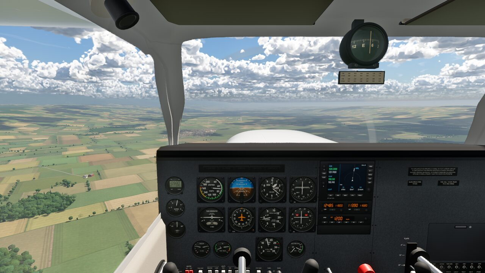
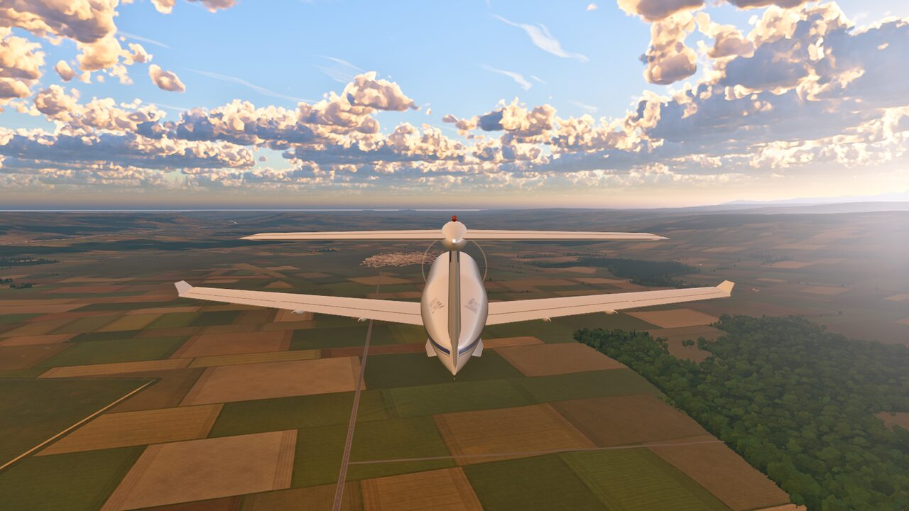
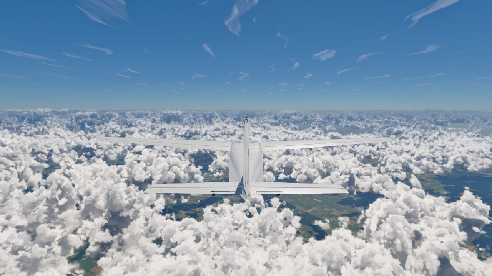
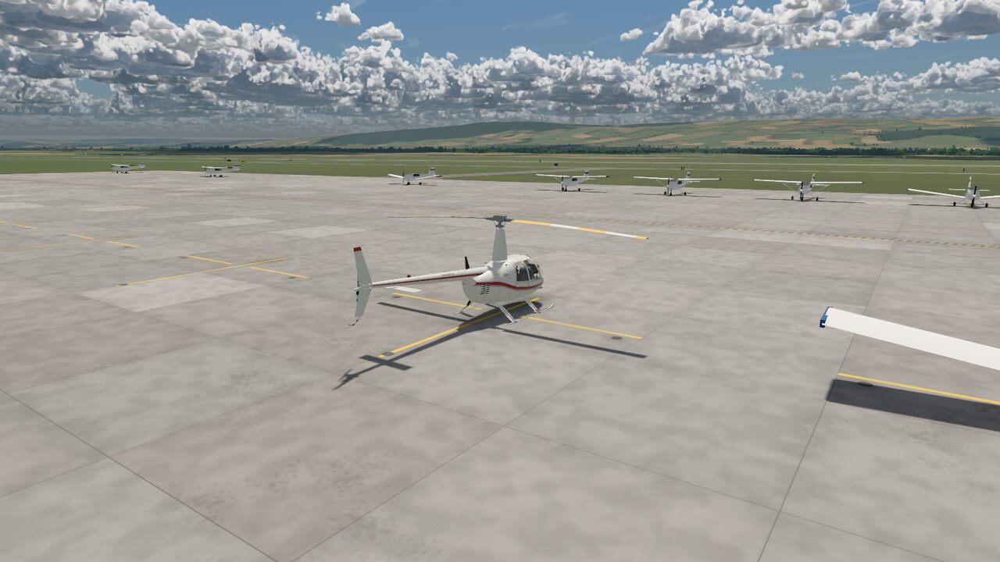
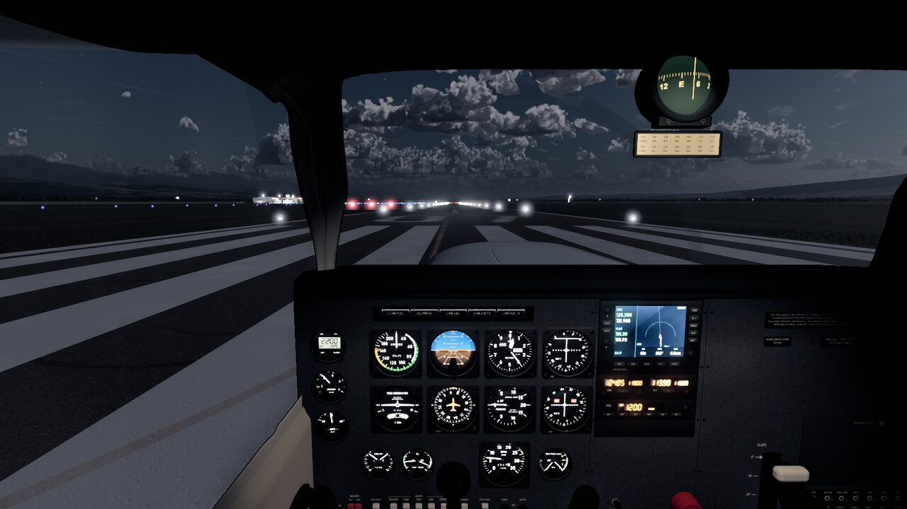
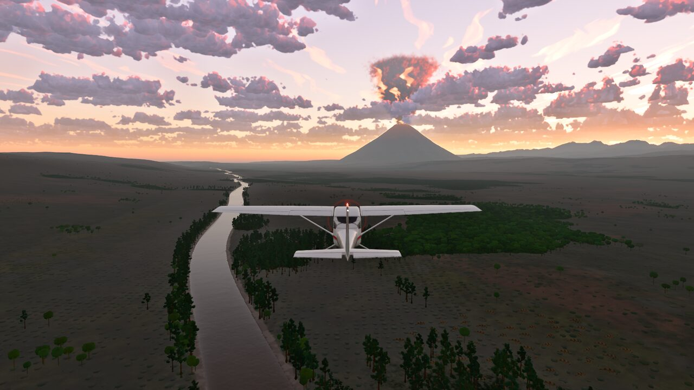
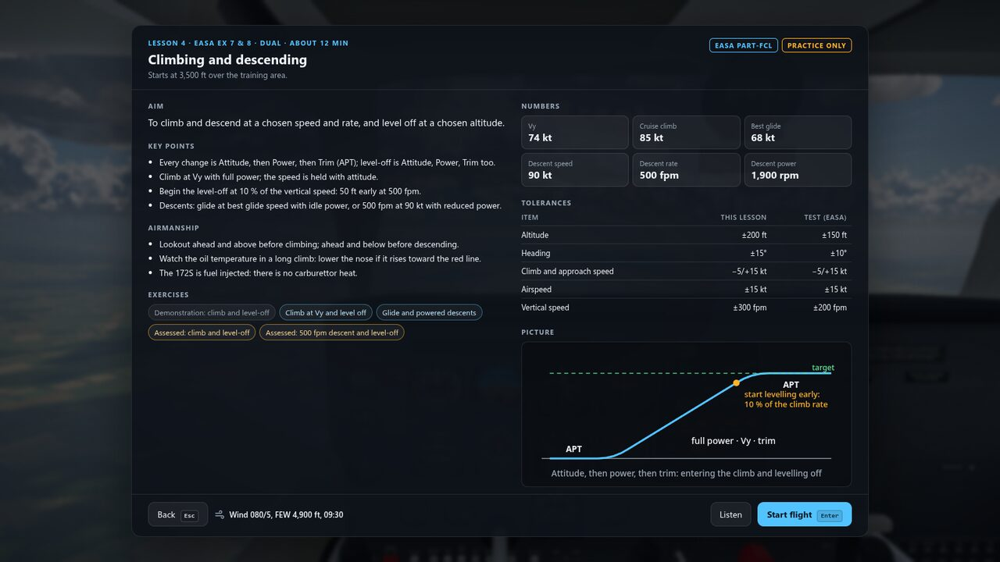

# fs: a light-aircraft and helicopter simulator in the browser

A physically based flight simulator in TypeScript, three.js and WebGL 2. The flight model is X-Plane-style
blade-element physics, not stability-derivative tables, and the world, aircraft, clouds, sky, instruments and
engine sound are all generated procedurally.



| | |
|---|---|
|  |  |
|  |  |
|  |  |

## Quickstart

You need a computer with a GPU that supports WebGL 2 (any recent laptop or desktop) and a current version of
Chrome, Edge, Firefox or Safari.

1. **Install Git** from [git-scm.com](https://git-scm.com/downloads). On Linux use your package manager
   (for example `sudo apt install git` or `sudo dnf install git`). On macOS, `xcode-select --install` also
   installs it.
2. **Install Node.js 22.12 or newer** (or 20.19 or newer) from [nodejs.org](https://nodejs.org/).
   This includes `npm`. Check it in a new terminal:
   ```sh
   node --version   # v22.12 or later
   ```
3. **Get the code and its dependencies:**
   ```sh
   git clone https://github.com/hendorog/flight-sim.git
   cd flight-sim
   npm install
   ```
4. **Start the simulator:**
   ```sh
   npm run dev
   ```
5. **Open <http://localhost:5173/>** in your browser. Loading takes a few seconds. You start lined up on the
   runway in a Cessna 172S with the engine idling.
6. **Fly.** Click once to turn on the sound. Release the parking brake with **Shift+B**, add full power with
   **F4**, and hold **↓** to raise the nose at about 55 knots. The keyboard yoke stays where you leave it, so once
   airborne tap **5** (or **↑**) to lower the nose to a climb attitude. Press **Escape** for the menu, where you can
   choose the aircraft, scenario, weather, time of day, graphics quality and joystick setup, and see the full
   list of keys.

To build a static copy for any web server, run `npm run build` (the output goes to `dist/`) and
`npm run preview` to try it. To fly from a phone or tablet on your network, use `npm run dev:https`:
browsers only play sound on a secure page.

## What's in it

- **Aircraft:** Cessna 172S, Cessna 152, Piper Tomahawk, Diamond DA20, Piper Seneca (twin), Cessna Caravan
  and Pilatus PC-12 (turboprops), plus the Robinson R22 and R44, Schweizer 300 and MD 500E helicopters. Each
  has its own flight model, 3D cockpit with a clickable panel, and engine systems. Some types are still in
  development. See [aircraft](docs/aircraft.md) and [known issues](docs/known-issues.md).
- **Physics:** a 6-DOF rigid body at 240 Hz. Lifting-line wings, blade-element propellers and rotors, piston
  and turbine engines with fuel and electrical systems, and tyre and strut landing gear. Performance is checked
  against POH figures in the test suite.
- **World:** procedural terrain with land cover, forests, towns and an airport with lighting. Volumetric
  clouds of several types, ground fog, rain, snow, thunderstorms with lightning, atmospheric scattering, an
  accurate sun, moon and night sky, wind, gusts and turbulence. Thunderstorm cells form on a procedural lattice
  wherever you fly, at a rate derived from the temperature, time of day, date, cloud base, cloud depth, cover and
  cloud type. Rain, snow and hail show on the windscreen in the cockpit view, hail bounces and lies on the
  ground, and large hail cracks the windscreen and dents the leading edges (more drag, higher stall speed). See
  [weather](docs/weather.md). A **Deep
  Time** mode lets you fly over a Cretaceous landscape with its fauna.
- **Flight School:** an instructor-led course from the first lesson to the PPL skill test. The instructor
  demonstrates, coaches you, takes control when needed, and grades each exercise against EASA or FAA
  standards. See [Flight School](docs/flight-school.md).
- **Controls:** keyboard, mouse yoke, and joysticks, yokes and pedals through the Gamepad API. You can use a
  3D cockpit or a fixed 2D instrument panel. An autopilot, time acceleration up to 16x, and resume on reload
  are included.

## Documentation

| Page | Contents |
|---|---|
| [Controls](docs/controls.md) | Every key, the fixed panel, mouse flight and the keyboard assists |
| [Aircraft](docs/aircraft.md) | The aircraft types, their differences from the C172S, and the helicopter demos and hover modes |
| [Scenarios and URL parameters](docs/simulator.md) | Start conditions, `index.html?...` options, the automation API, time acceleration, resume and sound |
| [Flight School](docs/flight-school.md) | Lessons, grading, the instructor's guidance and the school's keys and parameters |
| [Development](docs/development.md) | Performance, code layout, how the physics works, tests and screenshot tools |
| [Known issues](docs/known-issues.md) | Outstanding work by aircraft |

For development, run `npx tsc --noEmit` to type-check and `npx vitest run` to run the tests.

## License

Copyright (C) 2026 Roger Henderson

This program is free software: you can redistribute it and/or modify it under the terms of the GNU General Public
License as published by the Free Software Foundation, either version 3 of the License, or (at your option) any later
version.

This program is distributed in the hope that it will be useful, but WITHOUT ANY WARRANTY; without even the implied
warranty of MERCHANTABILITY or FITNESS FOR A PARTICULAR PURPOSE. See the GNU General Public License for more details.

You should have received a copy of the GNU General Public License along with this program (`LICENSE`). If not, see
<https://www.gnu.org/licenses/>.
